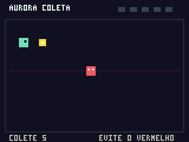

# Aurora — Aurora Coleta

**Aurora 0.3.0** integra um pequeno jogo caseiro de PS1 com controles ao aplicativo Windows x64. Em **Aurora Coleta**, mova o personagem verde, colete os cinco cristais amarelos e evite o guarda vermelho. Há pontuação, vitória, derrota e reinício.

[Baixar Aurora para Windows x64](https://github.com/Aspxexe/CHAT-GPT-CRIACOES/raw/refs/heads/main/downloads/Aurora-0.3.0-windows-x64.zip)



O jogo é um PS-X EXE próprio: movimento, colisões, pontuação, estados e desenho rodam em instruções MIPS interpretadas. O teclado alimenta o controle digital PS1 por SIO; não há lógica de gameplay no aplicativo Windows. Também acompanha uma ISO9660 própria do jogo. [Detalhes do homebrew](docs/homebrew-design.md).

O núcleo é próprio e experimental; não integra DuckStation, PCSX2, RPCS3, shadPS4 ou outros emuladores. Não há JIT. Este projeto ainda não roda Resident Evil 2 nem outros jogos comerciais ou os demais consoles planejados.

Nesta atualização, o volume ISO9660 declarar mais setores que os presentes no arquivo gera um aviso, em vez de rejeição imediata. O leitor continua exigindo que raiz, diretórios necessários, `SYSTEM.CNF` e executável estejam fisicamente disponíveis. Isso permite carregar arquivos de boot presentes sem declarar que a imagem inteira está íntegra. Se algum arquivo necessário estiver ausente, o erro informa seu LBA, os setores disponíveis/declarados, o tamanho do setor e o início da faixa.

PS2, PS3, PS4, PSP, PS Vita, Wii, Wii U, New 3DS, Xbox 360 e Xbox One ainda não possuem núcleos aqui. Os nomes na interface indicam planejamento, não compatibilidade.

## Testar o pacote Windows

1. Extraia `Aurora-0.3.0-windows-x64.zip` inteiro e abra o executável dessa pasta.
2. Abra `Aurora.exe`.
3. Clique em **Jogar Aurora Coleta**. O programa prepara e carrega o PS-X EXE original integrado; não é preciso procurar um jogo ou BIOS.
4. Use **setas ou WASD** para mover. **Enter ou R** envia START para reiniciar a partida. Ao sair da janela ou minimizá-la, o jogo pausa. Colete cinco cristais sem tocar no guarda vermelho.
5. Opcionalmente, adicione `aurora-coleta.iso` e use **Executar selecionado**. Isso percorre o leitor de disco e `SYSTEM.CNF`; os controles são os mesmos. `aurora-coleta.ps-exe` é a versão direta. `demo.iso` e **Demo gráfica anterior** mantêm a demonstração estática inicial.
6. Para outras imagens, extraia ZIP/7z/RAR primeiro. Selecione o `.cue` extraído e mantenha os BINs nos caminhos relativos indicados pelo CUE. ISO/BIN sem CUE também são detectados pelos layouts suportados. Isso não estabelece compatibilidade com seu jogo.
7. Se parar, clique em **Copiar último diagnóstico**. Ele preserva a última tentativa mesmo quando a importação falha e a demo anterior continua selecionada na biblioteca. O campo `Arquivo` identifica a mídia realmente analisada. Inclui formato, tamanho, layout, boot, contagens de setores e, quando houve execução, PC/opcode e registradores. A tentativa também é salva em `%LOCALAPPDATA%\AuroraPrototype\diagnostico.txt`.

A janela é uma biblioteca inicial, não uma interface completa equivalente à Steam. Os caminhos do acervo e a demonstração são salvos em `%LOCALAPPDATA%\AuroraPrototype`. **Adicionar arquivo** encerra a sessão anterior e limpa a prévia, para não atribuir a execução da demo à nova mídia. **Remover do acervo** não apaga o arquivo original. Não há download de jogos, instalação de PKG ou execução de arquivos pelo sistema operacional. O leitor não modifica imagens de disco nem extrai seu conteúdo para o host.

É necessário Windows x64 e driver com Vulkan 1.1, com apresentação Win32 e cópia para swapchain. A GTX 1660 Super suporta Vulkan com drivers adequados; isso não estabelece desempenho ou compatibilidade com jogos. O driver fornece `vulkan-1.dll`; o pacote não inclui nem substitui o driver.

**Validação:** a demo 0.1 foi confirmada pelo usuário no Windows/GTX 1660 Super. O pacote 0.3.0 foi gerado por cross compilation no Debian. Seis suítes nativas passaram, incluindo 15 testes de IO e 7 de jogabilidade. Vitória e derrota foram exercitadas por entradas do controle, sem alterar posições ou pontuação na RAM. IO e homebrew passaram também com ASan/UBSan. O PS-X EXE e sua ISO produziram o mesmo framebuffer, inspecionado visualmente. A nova interface e o mapeamento do teclado ainda precisam de teste em Windows; não houve teste em console PS1 físico ou com Resident Evil 2.

## O que está implementado

- CPU interpretada MIPS I, little-endian: ALU, desvios com delay slot, cargas com load delay, loads/stores alinhados, registradores HI/LO e multiplicação/divisão.
- RAM de 2 MiB com aliases e espelhos, scratchpad de 1 KiB, carregamento validado de PS-X EXE.
- GPU parcial: GP0 `02h` Fill Rectangle e `60h` retângulo sólido variável em VRAM de 1024 × 512, RGB555, clipping, offsets e máscara. GP1 inicializa estado básico de display; o reset limpa parser/estado de desenho sem apagar VRAM. GPUSTAT expõe prontidão coerente com a GPU síncrona e flags básicas.
- Vulkan: upload do framebuffer e apresentação em janela, escalados por vizinho mais próximo. Os retângulos são rasterizados na CPU; não há pipeline de polígonos, tradução de shaders ou tradução GNM/GNMX de PS4.
- Biblioteca local simples, persistência de caminhos, identificação de mídia e demo própria sem BIOS.
- Controle digital PS1 pela sequência SIO `01 42 00 00 00`, com bits ativos em zero, snapshot por transação e FIFO limitada. Setas/WASD e Enter/R são mapeados pelo host. Não há suporte a joystick USB/XInput nesta versão.
- `I_STAT`/`I_MASK` básicos e solicitação VBlank por quadro. O programa convidado aguarda e reconhece VBlank por polling. O host agenda quadros aproximadamente a 60 Hz, sem temporização precisa ou entrega de interrupções à CPU.
- Leitor ISO9660: setores de 2048, 2336, 2352 e 2448 bytes; MODE1/MODE2 Form1, pregap inicial de 150 setores e CUE com `INDEX 01` em faixa de dados. Diretórios/subpastas, nomes sem distinção de caixa e versões `;1`, `SYSTEM.CNF` e fallback `PSX.EXE` na raiz.
- Carregamento direto experimental do programa PS1 em RAM, sem executar BIOS de boot. Chamadas BIOS A0/B0/C0 são interrompidas explicitamente; não há stubs que finjam atender essas chamadas.
- Diagnósticos de arquivos compactados e estruturas de outros consoles, limites de leitura e trace limitado às últimas 32 instruções tentadas.

Não há JIT/recompilação dinâmica. A CPU convidada é interpretada; isso continua sendo **emulação**, mesmo com o aplicativo compilado para Windows e a saída gráfica usando Vulkan. Um arquivo ISO é um contêiner de disco, e não uma descrição universal de CPU ou GPU.

## Formatos

| Arquivo/conteúdo | Comportamento atual |
| --- | --- |
| PS-X EXE, independentemente da extensão | Valida cabeçalho/payload e tenta executar no subconjunto PS1. Instruções ou dispositivos ausentes interrompem com erro. |
| ISO9660 | Valida estrutura, procura `SYSTEM.CNF`/`BOOT` e carrega o PS-X EXE na CPU parcial. Sem BIOS ou leitura de disco durante a execução. |
| BIN/RAW 2336/2352/2448 | Detecta faixa ISO9660 MODE1/MODE2 Form1 e tenta o mesmo carregamento direto. Um BIN genérico pode permanecer desconhecido. |
| CUE | Resolve a primeira faixa de dados MODE1/2352 ou MODE2/2352 e seu `INDEX 01`. Não reproduz áudio ou emula troca de disco. |
| PKG | Reconhece assinatura; não determina console, valida o pacote inteiro, instala ou descriptografa. |
| ZIP/7z/RAR, CHD e CSO/ZSO | Exibe diagnóstico do contêiner/compressão; não descompacta ou executa. |
| Estruturas PSP, PS2, GameCube e Wii | Informa que o núcleo correspondente está ausente, sem tentar executar como PS1. |
| Outros | Exibe como desconhecido; não confia apenas na extensão. |

CUEs só podem referenciar arquivos dentro da própria pasta ou subpastas. Referências absolutas, ausentes ou que escapem desse diretório são rejeitadas. UTF-8 BOM e metadados `FLAGS DCP/PRE/SCMS/4CH` são aceitos, sem implementar seus efeitos de áudio. O parser é limitado, não uma implementação completa de todos os dialetos CUE. Verifica limites, sincronismo/modo e campos estruturais; **não verifica EDC/ECC nem integridade completa do disco**. Imagens intercaladas, arquivos multi-extent e MODE2 Form2 como dados ISO não são suportados.

## Limitações do núcleo PS1

Ainda faltam COP0/exceções arquiteturais, LWL/LWR/SWL/SWR, GTE, entrega de interrupções à CPU, temporização precisa, DMA, BIOS/HLE, CD-ROM durante execução, SPU/áudio, MDEC, controles analógicos, IRQ/temporização serial, memory cards e a maior parte da GPU. Resident Evil 2 depende de muitos desses recursos: localizar seu executável **não o torna jogável**. Overflows, regiões de memória desconhecidas e instruções ausentes param o protótipo em vez de simular funcionamento. Não há estado salvo ou sincronização precisa de CPU/GPU. O homebrew não tem som.

O framebuffer é uma visão simplificada da VRAM a partir do início de display. GPUSTAT tem o campo de interlace fixo; ranges e modo de display não fornecem um scanout completo. O jogo caseiro usa o subconjunto suportado. Não há alegação de compatibilidade com um console físico só porque seu programa usa instruções e registradores PS1.

O próximo marco útil é completar CPU/exceções e periféricos básicos, validar com homebrew e testes de hardware, depois adicionar polígonos/texturas, áudio, CD-ROM e boot. Cada família de consoles exigirá seu próprio núcleo e validação. Xbox One e demais plataformas não têm execução prometida neste projeto.

## Compilar e testar no Linux

Requisitos: compilador C++17, CMake 3.20+ e Make ou Ninja. O CLI e os testes não precisam de Vulkan.

```sh
cmake -S . -B build-native -DCMAKE_BUILD_TYPE=Debug
cmake --build build-native --parallel 4
ctest --test-dir build-native --output-on-failure
./build-native/aurora-cli --make-demo build-native/demo.ps-exe
./build-native/aurora-cli --inspect build-native/demo.ps-exe
./build-native/aurora-cli --run build-native/demo.ps-exe --ppm build-native/demo.ppm
python3 tools/make-demo-iso.py build-native/demo.ps-exe build-native/demo.iso
./build-native/aurora-cli --run build-native/demo.iso --ppm build-native/demo-disc.ppm
cmp build-native/demo.ppm build-native/demo-disc.ppm
./build-native/aurora-cli --probe build-native/demo.iso --report build-native/diagnostico.txt
./build-native/aurora-cli --make-homebrew build-native/aurora-coleta.ps-exe
python3 tools/make-demo-iso.py build-native/aurora-coleta.ps-exe build-native/aurora-coleta.iso --volume AURORA_COLETA --boot COLETA.PSX
./build-native/aurora-cli --run build-native/aurora-coleta.iso --ppm build-native/homebrew.ppm
```

`--run` executa até 50.000 instruções e `--probe` até 250.000, com um evento VBlank inicial e controle solto. Não são modos interativos; use o aplicativo Windows para jogar. `--probe` salva o relatório mesmo se o carregamento ou a CPU falharem, retornando código 1 na falha. Código 0 significa apenas que não houve falha dentro do orçamento. `--diagnose ARQUIVO` coleta metadados sem executar; `--inspect` identifica o formato. A saída PPM verifica CPU → MMIO GP0 → VRAM sem uma GPU. O gerador ISO recusa sobrescrever saída existente.

## Compilar no Windows

Requisitos: Visual Studio com desenvolvimento C++ para desktop/Windows SDK, CMake e os cabeçalhos do Vulkan SDK. O código carrega o loader do driver dinamicamente, sem link com `vulkan.lib`.

Em um terminal de desenvolvimento x64:

```powershell
cmake -S . -B build-local -A x64 "-DVULKAN_HEADERS_DIR=$env:VULKAN_SDK/Include"
cmake --build build-local --config Release --parallel 4
ctest --test-dir build-local -C Release --output-on-failure
.\build-local\Release\Aurora.exe
```

Esses comandos MSVC estão documentados, mas não foram executados nesta máquina Linux. O pacote fornecido foi gerado com MinGW GCC 14 em modo estático, sem DLLs redistribuíveis de MinGW.

## Cross compilation Linux → Windows

Requisitos adicionais: `g++-mingw-w64-x86-64-posix` e cabeçalhos Vulkan. O script de toolchain aceita um prefixo via `MINGW_ROOT`.

```sh
MINGW_ROOT=/usr cmake -S . -B build-windows \
  -DCMAKE_TOOLCHAIN_FILE=tools/mingw-toolchain.cmake \
  -DVULKAN_HEADERS_DIR=/usr/include \
  -DBUILD_TESTING=OFF -DCMAKE_BUILD_TYPE=Release
cmake --build build-windows --parallel 4
```

No ambiente cloud atual, as ferramentas foram extraídas de pacotes Debian autenticados em `/workspace/toolchains/windows`, sem instalação root. Use `tools/setup-cloud.sh` para reproduzir a preparação e `tools/build-cloud.sh` para compilar/testar. Não é necessário criar outro checkout ou worktree.

## Organização

- `src/cpu.cpp`: interpretador MIPS I.
- `src/ps1_memory.cpp`: RAM, MMIO e subconjunto GPU.
- `src/media.cpp`: inspeção, loader e programa de demonstração próprio.
- `src/disc.cpp`: setores, CUE, diretórios ISO9660 e boot direto PS1.
- `src/execution.cpp`: carregamento comum para CLI/GUI, parada em BIOS ausente e trace.
- `src/homebrew.cpp`: assembler/gerador do PS-X EXE e programa original Aurora Coleta.
- `src/vulkan_presenter.cpp`: apresentação Vulkan Win32.
- `src/windows_app.cpp`: biblioteca e janela Windows.
- `tests/`: testes de CPU, formatos e execução integrada da demo.

O repositório não inclui BIOS, firmware, chaves ou jogos comerciais. As dependências de compilação não fornecem núcleos de emulação.
